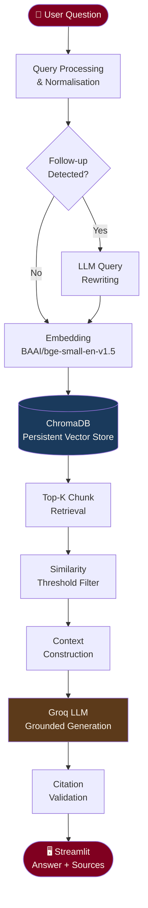

# 🪔 Ramayana AI — Ask the Epic

> **A complete, end-to-end Retrieval-Augmented Generation (RAG) chatbot grounded in indexed Ramayana texts.**  
> Answers are not invented — they are retrieved from your document collection and generated with full source citations.

---

## Architecture



---

## How RAG Works Here

Unlike a plain chatbot that relies purely on the LLM's pretrained memory, this application:

1. **Indexes your documents** — Ramayana texts are split into overlapping chunks, embedded using a local sentence-transformer model, and stored in a persistent ChromaDB vector database.
2. **Retrieves relevant passages** — Your question is embedded and compared against all indexed chunks. The most semantically similar passages are retrieved.
3. **Constructs grounded context** — Retrieved passages (not the whole book) are assembled with source labels and passed to the LLM.
4. **Generates a cited answer** — The LLM is explicitly instructed to use only the retrieved evidence, cite sources, and acknowledge when evidence is insufficient.
5. **Validates citations** — The system cross-checks every `[Source N]` citation against the actual retrieved chunks to prevent hallucinated references.

---

## Technology Stack

| Component | Technology |
|-----------|-----------|
| Language | Python 3.11+ |
| UI | Streamlit |
| Embeddings | sentence-transformers (`BAAI/bge-small-en-v1.5`) |
| Vector Store | ChromaDB (persistent local) |
| LLM | Groq API (`qwen/qwen3.8-27b`) |
| Alt LLM | Ollama (local) |
| Document Loaders | pypdf, built-in |
| Configuration | python-dotenv |
| Testing | pytest |

---

## Project Structure

```
ramayana-rag-chatbot/
├── app.py                    ← Streamlit entry point
├── requirements.txt
├── .env.example              ← Copy to .env and fill in your key
├── .gitignore
├── pytest.ini
├── README.md
│
├── data/
│   ├── README.md             ← Source doc guidance & attribution
│   └── documents/
│       └── demo_ramayana.txt ← Public-domain demo corpus (Griffith 1870)
│
├── vectorstore/
│   └── chroma/               ← Persistent ChromaDB (auto-created)
│
├── src/
│   ├── config.py             ← Centralised settings from env vars
│   ├── document_loader.py    ← PDF / TXT / MD loaders with metadata
│   ├── text_splitter.py      ← Overlapping chunk splitter
│   ├── embeddings.py         ← Sentence-Transformer wrapper
│   ├── vector_store.py       ← ChromaDB CRUD
│   ├── retriever.py          ← Dense retrieval + deduplication
│   ├── query_rewriter.py     ← Follow-up question rewriting
│   ├── prompt_templates.py   ← Grounded system/user prompts
│   ├── generation.py         ← Groq + Ollama clients (streaming)
│   ├── rag_pipeline.py       ← End-to-end orchestration
│   ├── citations.py          ← Citation extraction & validation
│   ├── evaluation.py         ← Recall@k, Precision@k, MRR metrics
│   └── utils.py              ← Text cleaning, hashing, token counting
│
├── scripts/
│   ├── ingest_documents.py   ← CLI ingestion pipeline
│   ├── rebuild_index.py      ← Full index rebuild
│   └── evaluate_rag.py       ← Evaluation suite
│
└── tests/
    ├── test_document_loader.py
    ├── test_text_splitter.py
    ├── test_retriever.py
    ├── test_citations.py
    └── test_rag_pipeline.py
```

---

## Prerequisites

- **Python 3.10 or higher** (3.11 recommended)
- **Windows 10/11** (PowerShell)
- **Groq API key** (free at [console.groq.com](https://console.groq.com)) — required for answer generation only
- **Internet connection** — for the first embedding model download (~130 MB)

---

## Installation (Windows PowerShell)

### 1. Clone / open the project
```powershell
cd d:\RAG-Ramayana
```

### 2. Create a virtual environment
```powershell
python -m venv venv
```

### 3. Activate the virtual environment
```powershell
.\venv\Scripts\Activate.ps1
```
> If you get an execution policy error, run:  
> `Set-ExecutionPolicy -ExecutionPolicy RemoteSigned -Scope CurrentUser`

### 4. Install dependencies
```powershell
pip install -r requirements.txt
```

### 5. Configure environment variables
```powershell
Copy-Item .env.example .env
notepad .env
```

Fill in your Groq API key:
```
GROQ_API_KEY=gsk_your_key_here
```

---

## Configuring Groq (Recommended)

1. Go to [console.groq.com](https://console.groq.com) and sign up (free).
2. Create an API key.
3. Add it to your `.env` file as shown above.
4. The default model is `llama-3.3-70b-versatile`.

---

## Configuring Ollama (Local Alternative)

1. Install Ollama from [ollama.ai](https://ollama.ai).
2. Pull a model: `ollama pull llama3`
3. In `.env`, set:
   ```
   LLM_PROVIDER=ollama
   OLLAMA_MODEL=llama3
   ```

---

## Adding Ramayana Documents

A demo dataset is included (`data/documents/demo_ramayana.txt`). For comprehensive coverage, add full Kanda texts:

1. Download public-domain editions (see `data/README.md` for sources).
2. Place `.pdf`, `.txt`, or `.md` files in `data/documents/`.
3. Run ingestion (see next section).

---

## Ingesting Documents

### Incremental ingestion (skips unchanged files)
```powershell
python scripts/ingest_documents.py
```

### Full rebuild
```powershell
python scripts/ingest_documents.py --rebuild
```

### Check index status
```powershell
python -c "from src.config import settings; from src.vector_store import VectorStore; vs = VectorStore(settings.vectorstore_dir, settings.chroma_collection_name); print(f'Indexed chunks: {vs.count()}')"
```

---

## Launching the Chatbot

```powershell
streamlit run app.py
```

The application opens in your browser at `http://localhost:8501`.

---

## Running Tests

```powershell
pytest tests/ -v
```

Tests that do **not** require external services or a populated index:
- `test_document_loader.py` — file loading, metadata, deduplication
- `test_text_splitter.py` — chunking, overlap, token counts
- `test_citations.py` — citation extraction and validation
- `test_retriever.py` — retriever logic (mocked vector store)
- `test_rag_pipeline.py` — pipeline orchestration (mocked dependencies)

---

## Evaluating Retrieval Quality

Requires a populated index:
```powershell
python scripts/evaluate_rag.py --top-k 5
```

This reports:
- **Recall@5** — fraction of expected keywords retrieved
- **Precision@5** — fraction of retrieved content that was relevant
- **Hit Rate** — fraction of queries with at least one relevant result
- **MRR** — Mean Reciprocal Rank

---

## Common Errors & Troubleshooting

| Error | Solution |
|-------|----------|
| `GROQ_API_KEY not set` | Add key to `.env` file |
| `Vector store is empty` | Run `python scripts/ingest_documents.py` |
| `Failed to load embedding model` | Check internet connection; model downloads on first use |
| `chromadb` version conflict | Run `pip install chromadb --upgrade` |
| `Execution policy` error | `Set-ExecutionPolicy -ExecutionPolicy RemoteSigned -Scope CurrentUser` |
| App crashes on startup | Activate venv first: `.\venv\Scripts\Activate.ps1` |

---

## Privacy & Data Handling

- All document embeddings are stored locally in `vectorstore/chroma/`.
- No document text is sent externally except as part of the LLM context window sent to Groq.
- API keys are read from environment variables and never exposed in the UI.

## Source Attribution

The demo dataset (`demo_ramayana.txt`) is drawn from:
- Griffith, Ralph T.H. (translator). *The Ramayana of Valmiki*. Benares: E.J. Lazarus and Co., 1870–1874.
- This translation is in the public domain.

## Known Limitations

- The demo dataset covers key episodes but not the complete epic; add full Kanda texts for comprehensive coverage.
- Answer quality depends on the quality and coverage of indexed documents.
- Follow-up query rewriting uses an LLM call — when the API is unavailable, heuristic rewriting is used.
- Generation requires a Groq API key or a running Ollama instance.

## Future Improvements

- Hybrid BM25 + dense retrieval for better keyword precision
- Cross-encoder reranking for higher retrieval quality
- Multi-document QA with explicit tradition/edition comparison
- Persistent conversation history across sessions
- Support for Sanskrit Devanagari script documents
